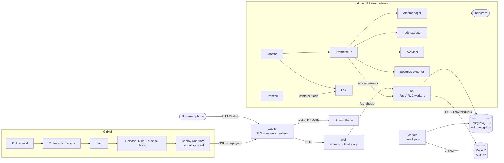

# Architecture

## Following one change to production

1. A branch and pull request. **CI** runs ruff, pytest, the web build, pip-audit, Gitleaks, Hadolint, ShellCheck, then builds the three images and scans them with Trivy. Any failure turns the pull request red and blocks the merge.
2. Merge to `main`. **Release images** builds `forgeops-api`, `forgeops-worker` and `forgeops-web`, tags them `sha-<commit>` and pushes them to `ghcr.io`. Tagging `v1.0.0` publishes the same images as `v1.0.0`.
3. **Deploy** (Actions > Deploy > Run workflow) with the version and `staging`. It checks the images exist, copies the compose files and scripts to `/opt/forgeops`, and runs `ops/scripts/deploy.sh`.
4. `deploy.sh` takes a backup, pulls the exact images, restarts api/worker/web, seeds if the database is empty, waits for `/health` and runs the smoke test. If health never arrives it rolls back to the previous version by itself.
5. Same workflow with `production`. The `production` environment needs a reviewer to approve before the job starts.
6. Grafana shows the traffic; Loki has the logs; Alertmanager pages Telegram if anything breaks.

## Networks and ports

| Thing | Reachable from | Why |
|---|---|---|
| Caddy 80/443 | the internet | the only public entrance |
| web 8080 | 127.0.0.1 only (Caddy in production) | no direct public access |
| api 8000, postgres 5432, redis 6379 | Docker `backend` network only | never published |
| Grafana 3000, Prometheus 9090, Alertmanager 9093 | 127.0.0.1, reach by SSH tunnel | monitoring stays private |
| `/metrics` | inside Docker only | Nginx doesn't forward it, Caddy returns 404 |

## Data

- `employees` (441 fictional rows) and `payroll_runs` in PostgreSQL. Tables are created by the API on start (`app/db.py`); seed data loads once via `docker compose run --rm seed`.
- Redis holds only the job queue and the worker heartbeat. Losing it loses at most queued jobs, which can be started again.
